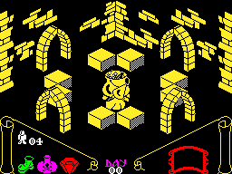

# Knight Lore

In case you've never heard of the _[Knight Lore](https://en.wikipedia.org/wiki/Knight_Lore)_ game, it is one of the first popular games
with _isometric_ graphics, which most people describe as 3D-like.

It was released back in 1984 for _[ZX Spectrum](https://en.wikipedia.org/wiki/ZX_Spectrum)_, an extremely popular
and cheap home computer of the 80s.



For anyone seeing the game for the first time in that times on that computer it seemed like magic. 
It was also extremely hard to play and I as a kid never got anywhere near its completion.

I was getting back to the Knight Lore on simulators, I also recreated the ZX Spectrum by hand 
(see my other repo [here](https://github.com/krzys9876/ZX_Spectrum_diy) and [here](https://github.com/krzys9876/ZX_Spectrum_FPGA))
and in code (see my [ZX Spectrum simulator in Scala](https://github.com/krzys9876/zx_spectrum_scala)).

That was a lot of fun but when it came to actual gameplay it didn't make it any easier. 
So I decided to rewrite the game in Java using the original source code[^1] that you can easily find 
in the Internet. I know Z80 assembler and ZX Spectrum internals well enough so that I can focus on actual logic.

Rewriting old code has an enormous educational value. Not only can I just play and tweak maximum lives, 
I can understand what was once a magic for me.

## State of the game ##

The game is now in the first playable version. You may clone the repo and run it in IntelliJ 

or:

```
    mvn package
    java -jar target/kl-0.1.jar
```

or download _jar_ file and run it.

Note that you need Java 25.

## Version history ##

### 0.1 ###
First playable version with hardcoded 99 lives and 99 days (counting from 0).


[^1]: Note that the _[Ultimate Play the Game](https://en.wikipedia.org/wiki/Ultimate_Play_the_Game)_ company was acquired by 
Microsoft so I don't want to publish the source code for obvious reasons.