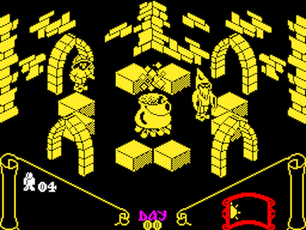
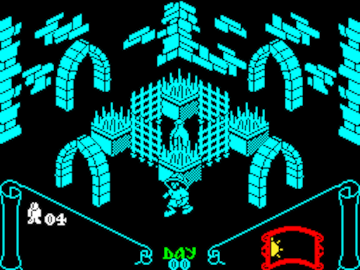
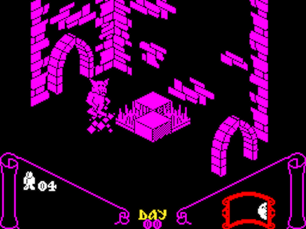
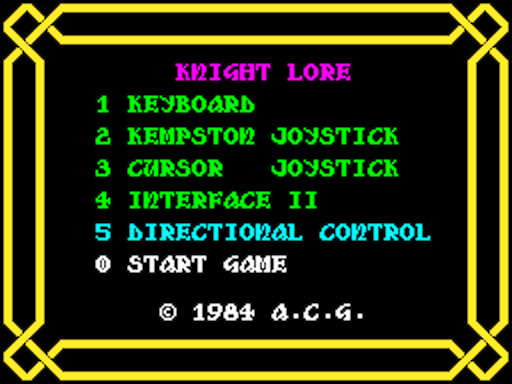
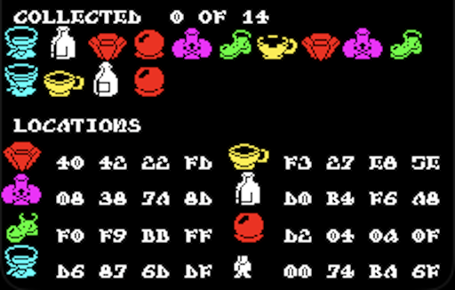

# Knight Lore

In case you've never heard of the _[Knight Lore](https://en.wikipedia.org/wiki/Knight_Lore)_ game, it is one of the first popular games
with _isometric_ graphics, which most people describe as 3D-like.

It was released back in 1984 for _[ZX Spectrum](https://en.wikipedia.org/wiki/ZX_Spectrum)_, an extremely popular
and cheap home computer of the 80s.







For anyone seeing the game for the first time in that times on that computer it seemed like magic. 
It was also extremely hard to play and I as a kid never got anywhere near its completion.

I was getting back to the Knight Lore on simulators, I also recreated the ZX Spectrum by hand 
(see my other repo [here](https://github.com/krzys9876/ZX_Spectrum_diy) and [here](https://github.com/krzys9876/ZX_Spectrum_FPGA))
and in code (see my [ZX Spectrum simulator in Scala](https://github.com/krzys9876/zx_spectrum_scala)).

That was a lot of fun but when it came to actual gameplay it didn't make it any easier. 
So I decided to rewrite the game in Java using the original source code[^1] that you can easily find 
in the Internet. I know Z80 assembler and ZX Spectrum internals well enough so that I can focus on actual logic.

Rewriting old code has an enormous educational value. Not only can I just play and tweak maximum lives, 
I can understand what was once a magic for me.

## State of the game ##

The game is now in the reasonably playable version with increased lives and time limits. You may clone the repo and run it in IntelliJ 

or go:

```
    mvn package
    java -jar target/kl-0.1.jar
```

or download _jar_ file and just run it.

Note that you need **Java 25**.

## How to play ##



In the original game you could select different control settings. So far only the keyboard is implemented 
(I don't think you have a joystick anyway) without _directional control_. So just press 0.

- To move forward press any key in the middle keyboard row, i.e. **A** to **L**.

- To turn use key pairs in lower row, i.e. **Z/X**, **C/V** etc. to turn **left/right** respectively.

- To jump press any key in upper keyboard row, i.e. **Q** to **P**.

- To collect or drop an object press **1** to **0**.

When the game ends press any key to return to the menu.

## Additional windows ##

In original game there could be no floating windows. It was always a mistery to me, where are the objects
and where I should go. It is not easy to navigate through the maze of rooms.

Now you can:
- see the map (a grid of 16 by 16, so it matches hexadecimal convention of 0..F)
- preview rooms that you are about to enter
- find all objects' locations. Note that locations are presented in original form: row followed by column. 

Call it cheating, but this is optional so you don't have to look at it.



## Version history ##

### 0.7 ###

Add floating window with object locations and list of required objects

### 0.6 ###

Add floating windows with room preview after clicking on the map

### 0.5 ###

Add floating windows with game map, debug info and shadow memory (if you are interested in it) 

### 0.4 ###
Significant internal refactor, preparation for future development

### 0.3 ###
Further improve debug information, enable optional game play (key sequence) save and replay

### 0.2 ###
Improve debug information, game parameters and menu loop

### 0.1 ###
First playable version with hardcoded 99 lives and 99 days (counting from 0).


[^1]: Note that the _[Ultimate Play the Game](https://en.wikipedia.org/wiki/Ultimate_Play_the_Game)_ company was acquired by 
Microsoft so I don't want to publish the source code for obvious reasons.